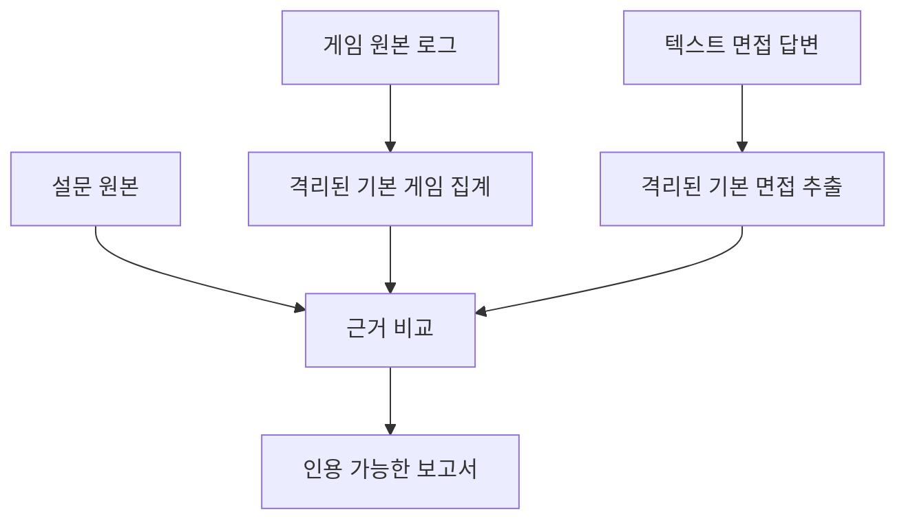

# AI 면접 연습 앱 수용 하네스 명세

## 1. 문서의 지위와 범위

이 문서는 설문 자기보고, 게임 행동 로그, 면접 자기보고 경험을 함께 다루는 AI 면접 연습 앱의 구현 인수 기준이다. `harness/scenarios.json`은 **실행 가능한 테스트가 아니라 수용 시나리오 픽스처**다. 다운스트림 Codex는 제품 어댑터와 실제 자동 테스트를 별도로 구현해야 하며, 픽스처를 읽었다는 이유만으로 통과를 선언해서는 안 된다.

**현재 실행 상태: `NOT IMPLEMENTED / NOT RUN`.** 이 패키지에는 애플리케이션, 제품 어댑터, 테스트 코드, 테스트 러너가 없으며 어떤 수용 시나리오도 실행 또는 통과되었다고 주장하지 않는다.

1차 범위는 텍스트 MVP다. 네 가지 설문 형식, B01~B03을 모두 관찰할 수 있는 독창적인 다중 라운드 게임 1개, 면접 후속 질문, 근거 추적 가능한 보고서, 인증·소유권 검사·삭제 기능을 포함한다. 비디오는 명시적으로 승인된 후속 단계에서만 선택적으로 다룬다. 유료 AI 요청과 운영 배포는 현재 승인 범위가 아니다.

저장소에 애플리케이션 스택이 이미 있으면 그 스택을 유지한다. 빈 저장소라면 제안 기준은 FastAPI, MySQL, HTML/CSS/JavaScript다. 이 하네스는 애플리케이션, 테스트 러너, 배포 설정을 구현하지 않는다.

## 2. 규범 용어와 판정 원칙

- **필수**는 자동화 불변식 테스트 또는 지정된 사람 검토에서 반드시 충족해야 한다.
- **금지**는 출력, API, 데이터 모델, UI 설명, 프롬프트, 보고서 어디에도 나타나면 안 된다.
- `deterministic_invariant` 시나리오는 필수 자동 테스트 대상이다. 제품 동작 케이스는 실제 제품 경계를 호출하고 정적·구성·메타 케이스는 실제 artifact를 검사하며, 모두 하나 이상의 의미 있는 assertion을 가져야 한다.
- `human_review`와 `effectiveness_review` 시나리오는 자동 통과율과 분리해 보고한다. 사람 판단을 코드 assertion으로 위장하거나 모델이 자기 출력을 채점하게 해서는 안 된다.
- 실행하지 못한 경우 `blocked`, 의도적으로 적용 대상이 아닌 경우 `skipped`, assertion이 모두 만족된 경우에만 `passed`로 기록한다. 세 상태를 합치지 않는다.
- 오류, 누락, 외부 세션 자료, 철회된 자료, 오래된 버전은 조용히 제외한 뒤 점수를 내지 말고 근거 상태와 차단 사유를 노출한다.

## 3. 요구사항 ID

### 3.1 공통 추적성과 데이터 경계

| ID | 필수 요구사항 |
|---|---|
| DATA-001 | 모든 증거 레코드는 `user_id`, `run_id`, `attempt_id`, `item_id`, `item_version`, `instructions_version`, `presentation_id`, `presentation_order`, `status`, `started_at`, `completed_at`, `context`를 직접 보존하거나 변경 불가능한 부모 레코드 참조로 정확히 해석 가능해야 한다. 해당되지 않는 값은 명시적 `null`과 사유를 사용하며 임의 기본값을 만들지 않는다. |
| DATA-002 | 동일 사용자라도 다른 run/attempt의 자료를 자동 결합하지 않는다. 소유권과 세션 경계를 서버에서 검사한다. |
| DATA-003 | 문항, 지시문, 게임 상태, 질문, 전사본 등 인용되는 산출물은 사용 당시 버전으로 재현 가능해야 한다. 최신 버전으로 과거 기록을 덮어쓰지 않는다. |
| DATA-004 | 예제와 픽스처는 합성 데이터만 사용하며 민감한 실제 사용자 자료를 포함하지 않는다. |
| DATA-005 | 변경 요청은 멱등성 키와 정규화된 payload digest를 저장한다. 같은 키·같은 payload 재시도는 같은 결과를 반환하고 부작용을 반복하지 않으며, 같은 키·다른 payload는 충돌로 거부한다. |
| DATA-006 | 완료된 attempt/run은 불변이다. finalize와 늦은 변경이 경합하면 하나의 원자적 완료 스냅샷만 승리하며 완료 뒤 변경은 새 버전 또는 명시적 재개 절차 없이는 거부한다. |

### 3.2 설문 네 형식

| ID | 필수 요구사항 |
|---|---|
| SUR-001 | 6단계 순서형 응답은 당시 표시한 여섯 라벨, 라벨 순서, 선택 라벨과 위치를 보존한다. |
| SUR-002 | 6단계 값은 순서형이다. 확률, 등간 척도, 잠재 능력의 등거리 단위, 백분율로 해석하지 않는다. |
| SUR-003 | 상상한 타인 관점 응답은 같은 응답자의 자기 관점 응답과 쌍으로 보존하고 관점, 쌍 ID, 순서 효과를 기록한다. 독립된 제3자 평정으로 취급하지 않는다. |
| SUR-004 | 양극 슬라이더는 `min`, `max`, `step`, 양 끝 라벨, 초기 위치, 최종 위치, 상호작용 여부, 종료 사유와 시간을 보존한다. |
| SUR-005 | 사용자가 의도적으로 중앙을 선택한 경우와 손대지 않은 채 시간 초과된 경우를 구분한다. |
| SUR-006 | top-k 순위는 제시된 전체 후보 집합, 최종 선택 순서, k, 제시 순서를 보존한다. 미선택은 싫어함이나 0을 뜻하지 않으며 순위 간 거리도 알 수 없다. |

### 3.3 행동 정의와 매핑 등록부

| ID | 필수 요구사항 |
|---|---|
| BEH-001 | B01은 **결정 전에 다른 사람의 정보를 확인하는 행동**이다. 확인 기회와 결정 시점을 함께 기록한다. |
| BEH-002 | B02는 **개인 자원과 팀 자원을 배분하는 행동**이다. 가능한 자원, 제약, 실제 배분을 함께 기록한다. |
| BEH-003 | B03은 **새 증거가 제시된 뒤 선택을 수정하는 행동**이다. 새 증거 노출, 수정 기회, 전후 선택을 함께 기록한다. |
| BEH-004 | 광범위한 `협업` 태그만으로 B01, B02, B03 중 어느 것도 충족했다고 판정하지 않는다. |
| BEH-005 | B03 기회에서 새 증거 뒤 선택을 유지한 것도 허용된 관찰 결과다. 전후가 같으면 `unchanged_after_evidence`로 기록하며 수정 행동으로 세지 않는다. 새 증거 전에 일어난 변경은 그 증거에 따른 B03으로 귀속하지 않는다. |
| MAP-001 | 행동-관찰 매핑 등록부는 `mapping_id`, `behavior_id`, `reason`, `observable_proxy`, `preconditions`, `limitations`, `permitted_uses`, `version`, `practice_review_status`, `validity_status`, `reviewer_type`, `reviewer_id`, `reviewed_at`을 필수로 가진다. |
| MAP-002 | 매핑과 결과는 검증된 심리측정 척도, 성격 특성, 안정된 능력, 채용 적합성을 주장하지 않는다. |
| MAP-003 | `practice_review_status=approved_for_practice`는 프로젝트와 도메인의 연습용 사용 검토를 통과했다는 뜻만 가진다. 다른 Codex 역할도 검토자가 될 수 있으며 실제 `reviewer_type`과 `review_mode`에 기록한다. `validity_status`는 별도로 유지하며 `provisional_unvalidated`를 사용한다. 두 상태를 결합하거나 실습 승인으로 타당화를 주장하지 않는다. |
| MAP-004 | 매핑 작성 단계에서 자기 결과를 자동 승인하지 않는다. 기본은 다른 검토자의 별도 검토다. 서브에이전트가 없는 환경은 명시적인 별도 검토 패스와 검토 근거·시간·한계를 남긴 후 연습용 활성화할 수 있으나 `review_mode=same_agent_separate_pass`를 기록하고 독립 검토라고 주장하지 않는다. |

### 3.4 게임 계측과 집계

| ID | 필수 요구사항 |
|---|---|
| GAM-001 | 게임은 조건, 제한 시간, 보상 규칙, 난이도, 가능한 행동, 행동 기회, 로그 순서, 상태 버전, 재현에 필요한 seed를 기록한다. |
| GAM-002 | 관찰된 행동과 사용자가 설명한 이유를 별도 필드와 별도 근거 유형으로 저장한다. 이유를 행동 로그로 바꾸거나 행동으로 동기를 단정하지 않는다. |
| GAM-003 | 횟수나 비율에는 적격 기회 분모와 분자 정의가 따라야 한다. 기회가 0이면 0점이 아니라 산출 불가다. |
| GAM-004 | 로그에서 인과 효과를 주장하지 않는다. 정보를 열거나 읽음 이벤트가 있었다는 사실을 이해·동의·신뢰의 증거로 해석하지 않는다. |

### 3.5 면접 기록과 추출

| ID | 필수 요구사항 |
|---|---|
| INT-001 | 질문 원문, 질문 버전, 대상 행동, 출처 참조, 질문 전에 공개된 이전 결과를 보존한다. |
| INT-002 | 텍스트 MVP는 입력 답변 원문과 정정 버전을 구분한다. 인용 오프셋은 인용 대상인 불변 답변 버전에 대한 Unicode code point 인덱스의 반개구간 `[start,end)`이며 UTF-8 바이트나 JavaScript UTF-16 code unit 인덱스가 아니다. 미래 미디어 단계의 전사 버전·타임스탬프 필드는 스키마에 둘 수 있지만 현재 런타임 요구사항은 아니다. |
| INT-003 | 텍스트 MVP는 `asked_answered`, `unasked`, `asked_no_text`, `asked_no_mention`을 구분한다. 미래 미디어 스키마의 `asr_failure`도 별도 상태로 예약하되 현재 ASR 런타임을 요구하지 않는다. 누락·무응답·미언급·향후 ASR 실패를 행동 부재로 바꾸지 않는다. |
| INT-004 | 얼굴, 표정, 감정, 진실성, 거짓말, 성격을 점수화하거나 추론하지 않는다. |

### 3.6 파이프라인과 비교 보고서

| ID | 필수 요구사항 |
|---|---|
| PIPE-001 | 기본 게임 집계와 기본 면접 추출은 시스템 입력을 격리해 완료한 뒤 비교한다. 이는 통계적 독립성이나 진실 검증 주장이 아니다. 기본 게임 집계는 면접·설문 프로필을, 기본 면접 추출은 게임·설문 프로필을 시스템 입력으로 받지 않는다. |
| PIPE-002 | 기본 면접 추출의 시스템 입력 allowlist는 중립 기본 질문 원문/버전, 해당 답변 원문/버전, `behavior_id`, rubric 버전뿐이다. 사용자가 답변 안에서 설문·게임을 자발적으로 언급했다면 그 문자열을 삭제하지 않고 자기보고 원문과 제한을 보존한다. 기본 게임 집계의 allowlist는 게임 원본 이벤트·조건·상태와 승인된 매핑뿐이다. 양쪽 모두 시스템이 주입한 설문 및 상대 파이프라인 프로필 누출을 계보로 차단한다. |
| PIPE-003 | 순서는 중립 기본 질문 → 설문/게임 맥락 없는 기본 추출 → 예비 통합 → 적응형 후속 질문이다. 적응형 질문은 실제 질문 원문과 이전 근거 공개 내용을 보존하고 `conditioned_on_prior_evidence=true`로 별도 기록한다. 후속 답변은 독립 확인으로 세거나 기본 추출을 변경하지 않는다. |
| PIPE-004 | 기본 추출/집계 캐시와 조건부 적응형 캐시는 namespace와 cache key를 분리한다. 사용자, run, attempt, 모드, 질문/답변/게임 버전, rubric/mapping 버전을 키에 포함하며 조건부 결과가 기본 결과 캐시에 들어가면 실패다. |
| CMP-001 | 비교 상태는 `supports_statement`, `contextual_difference`, `needs_clarification`, `insufficient_evidence`, `not_comparable`만 사용한다. |
| CMP-002 | 임의의 일관성 점수(예: 87점), 정확도, 거짓말 확률, 채용 추천·탈락 예측을 만들지 않는다. |
| CMP-003 | 강한 자기보고는 관련되고 정당화된 근거가 있을 때 실제 강도 라벨을 보존해 질문 문구와 질문 초점을 더 구체적으로 조정할 수 있다. 사람이나 항목에 불균등한 검토 우선순위를 부여하거나 진실 신뢰도를 올리거나 보편적 벌점을 주지 않는다. |
| CMP-004 | 각 비교 판단은 사용한 증거 ID, 버전, 직접 인용/로그 범위, 제한을 추적 가능하게 제시한다. |
| CMP-005 | 판정 우선순위는 다음과 같다. 소유권 위반은 비교 상태를 내지 않고 거부한다. 호환되지 않는 행동·매핑·단위·버전은 `not_comparable`; 호환되지만 근거 누락·기회 없음·평가 불가는 `insufficient_evidence`; 맥락 기록으로 뒷받침된 조건별 관찰 차이는 인과 주장 없이 `contextual_difference`; 그 밖의 해결되지 않은 모호성은 `needs_clarification`; 호환 맥락의 명시적 지지 근거가 있을 때만 `supports_statement`다. |

### 3.7 보안, AI 런타임, 제품 범위

| ID | 필수 요구사항 |
|---|---|
| SEC-001 | 모든 읽기·수정·보고서·삭제 요청은 인증과 서버 측 소유권 검사를 거친다. |
| SEC-002 | 외부 세션, 누락, 철회, 소유권 불일치 증거를 분석에서 거부하고 이유를 기록한다. |
| SEC-003 | 오래된 버전, 범위를 벗어난 인용 오프셋, 조작된 인용·숫자를 탐지하며 사용자 답변 속 지시문은 신뢰할 수 없는 데이터로 취급한다. |
| SEC-004 | 캐시와 비동기 작업은 `user_id`, `run_id`, `attempt_id` 소유권을 키와 실행 시점 모두에서 검증한다. 사용자 또는 run 사이에서 결과, 작업, 진행 상태를 재사용하지 않는다. |
| SEC-005 | 삭제/철회 tombstone과 세대 번호를 작업 완료 시 다시 확인한다. 삭제 전에 시작해 삭제 뒤 끝난 작업은 결과를 쓰거나 캐시·보고서를 부활시키지 않는다. |
| SEC-006 | 답변·전사·질문 원문, API 키와 기타 민감 payload를 애플리케이션/접근/오류 로그에 기록하지 않는다. 로그는 불투명 ID, 상태, 길이, 시간, 버전 등 승인된 메타데이터만 담는다. 응답 선택을 역추측할 수 있는 payload hash도 일반 로그에 남기지 않는다. |
| AI-001 | 라이브 AI 공급자 키는 서버 환경 변수에서만 읽고 브라우저, 로그, 저장 응답에 노출하지 않는다. |
| AI-002 | mock 결과는 화면, API, 저장 레코드에서 `mock`으로 명시하며 라이브 결과와 혼합하지 않는다. |
| AI-003 | 유료 요청과 운영 배포는 별도 명시 승인 전 차단한다. |
| AI-004 | 입력 토큰, 출력 토큰, timeout, retry 한도를 서버 설정으로 강제한다. 요청이 최대 예산을 초과하면 공급자 네트워크 호출 전에 거부하며 한도 상향이나 자동 재시도로 우회하지 않는다. |
| AI-005 | 오프라인 테스트는 라이브 공급자 결과를 생성했다고 주장하지 않는다. 라이브 provenance가 필요한데 공급자 호출이 없으면 `blocked`이며, mock/live 혼합 provenance 산출물은 거부한다. |
| ARCH-001 | 기존 저장소에는 기존 스택을 유지하고, 빈 저장소의 기본 제안만 FastAPI/MySQL/HTML-CSS-JS로 한다. |
| MVP-001 | 텍스트 MVP는 네 설문 형식, B01~B03 다중 라운드 게임 1개, 후속 질문, 추적 보고서를 포함한다. |
| MVP-002 | 인증, 소유권 검사, 사용자 삭제가 MVP 수용 범위다. 삭제 후 원본·파생 산출물이 조회나 새 분석에 나타나지 않아야 한다. |
| MVP-003 | 비디오는 현재 MVP 밖이며 별도 단계와 승인이 있을 때만 추가한다. |

### 3.8 하네스와 효과성 평가

| ID | 필수 요구사항 |
|---|---|
| TST-001 | 제품 동작을 다루는 `deterministic_invariant`는 실제 제품 경계를 호출하고, 정적 구성·스키마·메타 검증 케이스는 실제 구성 또는 실제 테스트 결과 artifact를 검사한다. 모든 자동 테스트는 의미 있는 assertion을 하나 이상 둔다. |
| TST-002 | 사람 검토와 효과성 평가는 자동 불변식 결과와 분리하고 실행 전에는 `pending_manual`로 둔다. 이는 working code MVP 완료 조건이 아니며 수행했다면 표본, 평가자, 근거, 불일치를 기록한다. |
| TST-003 | 강도 보존 대 강도 붕괴 A/B는 동일한 동결 합성 데이터셋과 동일한 비강도 정보를 사용하고, 조건을 모르는 독립 평가자가 사전 정의된 루브릭으로 판단한다. |
| TST-004 | 사전 등록한 판정 기준과 실제 관측치만 보고한다. 수동 연구가 `pending_manual`이면 효과성 주장을 하지 않으며, 구현 완료를 연구 완료로 표현하지 않는다. 합성 정확도나 근거 없는 우월성 수치를 만들지 않는다. |
| RUN-001 | 다운스트림 구현은 픽스처 ID에서 실제 테스트 파일·테스트 이름으로의 매핑을 만들고, 존재·실행 결과를 검증해야 한다. 이 문서의 매핑은 미래 기대치이며 현재 테스트 존재 주장으로 읽지 않는다. |
| RUN-002 | assertion이 없는 테스트, 예외를 삼키는 테스트, 무조건 성공하는 러너는 실패다. `passed`, `failed`, `blocked`, `skipped`를 구분하고 사유를 남긴다. |

## 4. 원본 데이터와 파생 데이터 계약

원본 레코드는 추가 전용으로 취급한다. 정정은 새 버전을 만들고 이전 버전과 연결한다. 파생 산출물은 입력 증거 ID·버전, 매핑 버전, 알고리즘/프롬프트 버전, 생성 모드(`live` 또는 `mock`)를 가진다. 삭제 또는 동의 철회 시 파생 산출물도 무효화하고 재생성 대상에서 제외한다.

네 설문 모드의 권장 원본 형태는 다음과 같다.

| 모드 | 반드시 보존할 값 | 허용되지 않는 축약 |
|---|---|---|
| 6단계 순서형 | 여섯 라벨과 순서, 선택 라벨/위치, 문항·지시문 버전 | `0.8 확률`, `80점`, 등간 평균만 저장 |
| 자기/상상한 타인 쌍 | 같은 `respondent_user_id`, `pair_id`, 관점, 각 응답, 제시 순서 | 상상 응답을 동료 평정으로 저장 |
| 양극 슬라이더 | min/max/step, 양 끝 라벨, initial/final, touched, 종료 사유 | 중앙값만 저장하여 의도/무응답 혼합 |
| top-k | 전체 후보, 제시 순서, k, 선택 순서, 미선택 집합 | 미선택=0 또는 순위 간 동일 거리 |

## 5. 게임·면접·비교 처리 순서



게임 집계는 게임 원본 이벤트·조건·상태와 승인된 매핑만 사용한다. 중립 기본 면접 추출은 중립 질문, 해당 답변, 행동 ID, rubric 버전만 시스템 입력으로 사용하며 설문·게임 프로필을 주입받지 않는다. 이 격리는 통계적 독립성이나 진실 검증을 뜻하지 않는다. 사용자가 답변에서 이전 설문이나 게임을 자발적으로 언급하면 원문을 보존하고 자기보고라는 제한을 붙인다. 두 기본 결과가 고정된 후 설문과 함께 예비 통합한다. 그 다음 적응형 후속 질문은 설문 강도를 포함한 이전 근거를 정확히 인용할 수 있지만, 실제 질문 원문을 그대로 저장하고 조건부 근거로 분리한다. 후속 답변은 기본 면접 추출을 덮어쓰거나 독립된 확인으로 계산하지 않는다. 기본/조건부 캐시 namespace도 분리한다. 계보 검사에서 어느 기본 파이프라인이든 시스템이 설문 또는 상대 파이프라인 프로필을 입력하면 실패다.

비교 상태의 뜻은 다음과 같다.

| 상태 | 사용 조건 |
|---|---|
| `supports_statement` | 동일 행동·호환 맥락에 관한 직접 근거가 자기보고 진술과 함께 존재한다. 진술의 진실을 인증하지 않는다. |
| `contextual_difference` | 맥락·제약·기회가 다른 조건에서 서로 다른 관찰이 나타났음을 기술할 수 있다. 조건이 차이를 일으켰다는 인과 표현은 금지하며, `~때문에` 같은 이유 표현은 사용자가 그 이유를 명시적으로 자기보고했고 그 인용을 붙인 경우에만 사용자 설명으로 제시한다. |
| `needs_clarification` | 관련 근거가 있으나 이유나 맥락을 구분하려면 후속 질문이 필요하다. |
| `insufficient_evidence` | 관련 근거 또는 적격 기회가 부족하다. 0점으로 바꾸지 않는다. |
| `not_comparable` | 행동 정의, 버전, 단위, 맥락이 호환되지 않아 비교 자체가 부적절하다. |

판정은 `CMP-005`의 우선순위를 적용한다. 소유권 위반은 위 다섯 상태 중 하나로 축소하지 않고 요청 자체를 거부한다. 같은 입력이 여러 설명에 걸치면 호환성, 평가 가능성, 기록된 조건 차이, 남은 모호성, 명시적 지지 순서로 판정하며 임의 모순 점수를 만들지 않는다.

## 6. 자동화 불변식 계약

`harness/scenarios.json`에서 `category`가 `deterministic_invariant`인 모든 케이스는 필수다. 제품 동작 케이스는 실제 API/서비스/저장소 경계를 호출하고, 정적 구성·계획·메타 케이스는 실제 설정·스키마·테스트 결과를 검사한다. 각 케이스의 `expected`와 `forbidden`을 의미 있는 assertion으로 구현한다. 문자열 스냅샷 하나만 비교하는 대신 구조, 계보, 상태, 오류 코드를 직접 검증한다. 명세에 적힌 단어를 찾는 검사만으로 실제 제품 동작이 검증됐다고 주장하지 않는다.

향후 테스트 매핑의 최소 형식은 다음과 같다. 이는 아직 구현된 테스트 목록이 아니다.

```json
{
  "scenario_id": "SCN-001",
  "test_file": "tests/acceptance/test_survey.py",
  "test_name": "test_preserves_six_ordered_labels",
  "assertion_count": 4,
  "result": "passed|failed|blocked|skipped",
  "reason": null
}
```

권장 미래 파일 매핑은 다음과 같다.

| 시나리오 범위 | 기대 테스트 영역 |
|---|---|
| SCN-001~SCN-012 | `tests/acceptance/test_survey_and_identity.py` |
| SCN-013~SCN-018 | `tests/acceptance/test_behavior_mapping.py` |
| SCN-019~SCN-024 | `tests/acceptance/test_game_evidence.py` |
| SCN-025~SCN-030 | `tests/acceptance/test_interview_pipeline.py` |
| SCN-031~SCN-043 | `tests/acceptance/test_comparison_and_integrity.py` |
| SCN-044~SCN-050 | `tests/acceptance/test_runtime_scope_and_deletion.py` |
| SCN-051, SCN-053 | 사람 검토 프로토콜 및 결과 문서; 실행 전 `pending_manual`, 자동 통과로 합산 금지 |
| SCN-052 | `tests/acceptance/test_unicode_citations.py` |
| SCN-054~SCN-055 | `tests/meta/test_harness_adapter.py` |
| SCN-056~SCN-058 | `tests/acceptance/test_pipeline_isolation.py` |
| SCN-059~SCN-061 | `tests/acceptance/test_idempotency_and_finalization.py` |
| SCN-062~SCN-064 | `tests/acceptance/test_async_isolation_and_logging.py` |
| SCN-065 | `tests/acceptance/test_ai_budgets.py` |
| SCN-066~SCN-068 | `tests/acceptance/test_behavior_event_order.py` |

## 7. 사람 검토와 A/B 효과성 평가

사람 검토는 제품의 불변식 통과 여부를 대신하지 않으며 working code MVP 완료 게이트도 아니다. 실행 전 `human_review`와 `effectiveness_review`는 `pending_manual`로 남긴다. `human_review`는 보고서가 인용과 제한을 정확히 전달하는지, 문구가 심리측정 또는 채용 판단으로 과장되지 않는지를 본다. 수행할 때는 최소 두 명의 독립 평가자가 먼저 서로의 판단을 보지 않고 평가하며, 불일치는 원 판단과 조정 결과를 모두 남긴다.

`effectiveness_review`의 A/B는 같은 동결 합성 데이터셋을 두 변환으로 처리한다.

- A 조건은 6단계 순서형 응답만 긍정/부정으로 축약한 분석용 입력을 사용한다. 저장된 원본은 바꾸지 않는다.
- B 조건은 동일한 응답의 6단계 원 라벨과 위치를 보존한 분석용 입력을 사용한다.
- 이 첫 실험에서는 슬라이더·관점·top-k·게임·면접·누락 상태·레이아웃·모델·루브릭을 동일하게 둔다. 다른 입력 형식의 정보 손실 효과는 별도 실험으로 다룬다.
- 평가자는 조건명을 모른 채 `원 진술 충실성`, `근거 추적성`, `과잉 해석 회피`, `후속 질문 유용성`을 사전 정의된 루브릭으로 판단한다.
- 표본 수, 평가자 수, 누락, 불일치, 각 조건의 관측 결과를 그대로 보고한다. 통계 검정을 하지 않았다면 효과나 정확도 향상을 주장하지 않는다.

## 8. 완료 게이트

working code MVP 구현 완료를 주장하려면 다음 증거가 필요하다.

1. JSON Schema 수준의 필수 키 검사와 모든 시나리오 ID·요구사항 ID 참조 무결성 검사.
2. 모든 결정적 시나리오가 실제 테스트에 매핑되고 각 테스트에 의미 있는 assertion이 존재한다는 메타 테스트.
3. 실패·차단·건너뜀의 개별 목록과 사유. 차단/건너뜀을 통과율 분모에서 몰래 제거하지 않는다.
4. 외부 세션, 철회, 버전 불일치, 인용 범위, 프롬프트 주입, mock/live 구분에 대한 음성(negative) 테스트.
5. 유료 요청과 운영 배포가 실행되지 않았다는 구성 검증.

사람 검토와 A/B 연구가 수행되지 않았어도 위 자동 게이트를 만족한 working code MVP는 구현 완료로 표시할 수 있다. 다만 수동 항목은 계속 `pending_manual`로 표시하고 효과성, 정확도 향상, 사람 검토 완료를 주장해서는 안 된다. 효과성 연구 완료를 별도로 주장하려면 두 독립 평가자, 동결 데이터, 블라인드 조건, 실제 판정과 불일치 기록이 필요하다.

`harness/scenarios.json` 자체를 순회하며 `expected`를 그대로 반환하는 가짜 구현, 비어 있는 assertion, 항상 참인 assertion, 예외를 성공으로 바꾸는 래퍼는 수용 실패다.
