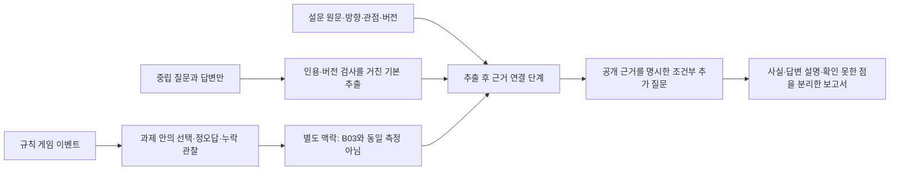

# 설문·게임·텍스트 면접은 어떤 근거로 연결되는가

> **2026-10-13 업데이트:** 아래 문서는 10월 12일의 설계·한계 근거를 보존한 것이다. 근거 연결·조건부 질문/답변·최종 확정은 이제 로컬 코드에 구현되어 합성 검사를 거쳤다. RG01 같은 신규 행동 매핑은 활성화하지 않고 게임 관찰은 별도 사실로 표시한다. 현재 실행 범위와 실제 AI/브라우저 미검증은 DELIVERY_20261013.md 및 최신 VERIFICATION.md를 따른다.

2026-10-12 현재 코드 기준. 이 문서는 현재 사실과 구현 후보를 구분한다. 자동 검사 통과나 AI 검토는 심리측정 타당화·직무성과 예측 정확도를 의미하지 않는다.

## 교수님께 먼저 설명할 핵심

“먼저 연습할 역량 주제를 구체적인 행동으로 나눕니다. 설문은 본인이 어떻게 행동한다고 생각하는지 묻고, 게임은 정해진 조건에서 실제로 누른 선택을 기록하며, 면접은 선택의 이유와 경험을 원문으로 확인합니다. 동일한 좁은 행동에 대해 비교 가능한 맥락인지 확인하고, 조건 차이를 함께 표시합니다. 결과에는 선택한 문항·게임 이벤트·면접 인용을 붙여 설명하고, 관찰하지 못한 부분은 확인되지 않았다고 표시합니다.”

현재 두 규칙 게임에서 직접 말할 수 있는 것은 **‘이 규칙·이 자극에서 이 선택을 했다’**이다. ‘현실의 협업 능력이 높다’는 별도의 검증이 필요한 주장이다. 면접의 명시적 설명도 경험이 실제 발생했음을 인증하지 않는다.

**2026-10-12 사용자 결정:** 현재 가위바위보·카드 게임을 유지한다. 규칙 전환 행동을 별도로 설명하고, 정보 확인·자원 배분은 설문과 면접 근거로 설명한다. 게임 추가나 기존 행동 정의 변경을 이 결정에 포함하지 않는다.

교수님께 말할 때 위 문단은 **설계 원리**로 소개한다. 현재 화면에는 자료를 모아 표시하는 기능까지 연결되어 있고, 아래의 조건부 질문·연결 설명 자동화는 남아 있다. 구현된 기능처럼 시연 설명을 하지 않는다.

## 현재 6문항의 연결 범위

| 문항 ID | 실제 물어보는 것 | 연결할 기본 면접 | 현재 가위바위보·카드와의 관계 | 허용 범위 |
|---|---|---|---|---|
| O-B01 | 공동 결정 전에 팀원이 아는 정보를 확인한다는 동의 정도 | baseline-b01: 누구에게 무엇을 확인했고 판단에 어떻게 반영했는가 | 타인 정보에 접근/질문하는 기회가 없음 | 설문 자기보고와 면접 자기보고를 연결. 현재 게임으로 검증할 수 없음 |
| P-B01 | 같은 정보 확인 행동에 대해 내가 보는 나와 내가 상상한 타인 관점 | baseline-b01 | 실제 타인 평가도, 게임의 정보 확인 행동도 없음 | 두 관점의 이유를 후속으로 물을 수 있음. 독립 증거 2개로 계산하지 않음 |
| O-B02 | 개인·팀 과제의 목표/제약을 확인한 뒤 시간을 배분한다는 동의 정도 | baseline-b02: 선택 대안, 배분 기준, 행동, 결과 | 자원을 개인/팀에 나누는 선택이 없음 | 설문과 면접의 배분 경험을 연결. 규칙 게임 점수로 배분 역량을 추정하지 않음 |
| S-B02 | 개인 과제와 팀 과제 중 어느 쪽 제약을 먼저 살필지 | baseline-b02에 배분 기준을 확인하는 질문 배경 | 규칙 정답이나 게임 점수와 비교할 수 없음 | 원문 표시·연습 질문용. 기본 매핑에도 evidence_comparison 허용이 없음 |
| O-B03 | 새 정보가 오면 처음 계획을 재검토한다는 동의 정도 | baseline-b03: 새 정보 뒤 선택을 유지/변경한 경험과 이유 | 규칙 변경 후 응답이라는 관련 소재는 있으나, 현재 게임은 새 자극에 답하며 이전 결정을 수정하지 않음 | ‘규칙 변경 때 무엇을 확인했는가’를 묻는 맥락 연결 후보. 기존 B03의 직접 검증으로 활성화하지 않음 |
| R-UNMAPPED | 연습 환경에서 중요하게 보는 세 항목의 순서 | 해당하는 기본 질문 없음 | 게임에 그 가치들을 실제로 선택하는 기회가 없음 | 선호 원본을 보존. 성장·도움 등을 골랐다고 학습/협업 능력 점수로 바꾸지 않음 |

**개수의 의미:** 6문항 중 5문항에는 B01/B02/B03을 주제로 한 기존 매핑이 있다. 그중 S-B02는 질문 배경/원본 표시만 허용한다. 비교 용도가 등록된 설문은 4문항이며, 한 사람에게서 나온 자기보고들이다. 현재 규칙 게임에 활성화된 B01/B02/B03 매핑은 **0개**다. 이를 ‘83% 검증’이나 연결 정확도로 표현하지 않는다. 현재 신규 보고서는 이 설문들을 표시하지만 설문을 실제 비교 함수의 입력으로 사용하지 않는다.

직접 근거: `app/content.py::SURVEYS, MAPPINGS, QUESTIONS`; `app/interview_analysis.py::_comparison, _survey_report, _rule_games_report`; `html/interview.js::baselineQuestions`.

위 4개는 정의에 등록된 비교 허용 용도 수다. 응답 누락·관점 미완료·버전 불일치가 있으면 해당 회차의 적격 근거 수는 줄어든다. 설문이 비교용으로 등록되어 있다는 사실과 실제 비교가 구현·실행되었다는 사실도 구분한다.

## 역량 주제를 실제로 설명하는 기준

다음 표는 새 능력 점수표가 아니다. 현재 질문과 `asked_criteria`가 요구하는 설명을 사람이 점검하는 기준이다. 답변에서 명시된 내용은 인용하고, 모자란 내용은 추가 연습 질문으로 연결한다.

| 연습 주제 | 어떤 구체적 근거를 확인하는가 | 근거가 있을 때 쓸 수 있는 설명 | 그 근거만으로 할 수 없는 말 |
|---|---|---|---|
| 정보 확인 | 상황·본인 역할, 누구에게 어떤 정보를 언제 확인했는지, 그 정보와 결정의 관계 | “답변에 팀원 일정 확인과 계획 반영 과정이 명시되어 있다.” 해당 답변/버전/인용을 제시 | “실제로 늘 협업을 잘한다.” 설문과 답변은 같은 사람의 자기보고 |
| 제한 자원 배분 | 총 시간/자원과 제약, 선택 대안, 실제 배분 설명, 선택 이유·결과·배움 | “개인/팀 제약과 배분 이유를 설명했다. 결과 설명은 부족해 추가 질문이 필요하다.” | “팀에 많이 배분했으므로 능력이 높다.” 또는 S-B02 방향을 배분량으로 해석 |
| 새 정보 뒤 재검토 | 처음 선택, 새 정보, 유지/변경한 선택, 재검토 이유·결과·배움 | “어떤 정보 때문에 선택을 유지/변경했다고 설명했는지 인용할 수 있다.” | “게임의 규칙 정답률이 높으므로 현실의 적응력이 높다.” |
| 규칙 변경 후 선택 | 공개 이벤트, 같은 이벤트의 자극·선택·적용 규칙·정오답, 공개/응답 누락 | “이 라운드에서 공개 후 수락 응답 4개 중 2개가 당시 규칙에 맞았다.” | “그 사람의 역량이 50%다.”, “이전 규칙에 맞는 선택은 고집이다.” |

기본 면접의 `explicit/partial/not_mentioned/not_asked/unassessable`은 **답변에 필요한 설명이 있는지**에 대한 상태다. 사람의 능력 등급이 아니다. 예컨대 B02의 `other_information`은 원래 묻지 않아 `not_asked`이며 부족한 역량으로 감점하지 않는다. mock에서는 텍스트가 있어도 의미 추출을 했다고 꾸미지 않고 `ai_not_used`로 남긴다.

이 그림은 완성 목표다. J/F 및 최종 확정 경로는 현재 새 HTML 흐름에 미연결이다. AI는 E에서 답변 구절을 정리하는 역할이고, 기록·정오답·인용 위치·허용 매핑·버전은 서버 규칙으로 대조한다. AI의 해석 자체가 옳은지는 별도의 사람 평가가 필요하다.

## 현재 게임에서 실제로 알 수 있는 것

각 게임은 20초 라운드 3개이며 10초 경과 후 규칙 공개 요청이 가능하다. 서버가 공개한 시각, 당시 규칙, 자극, 선택, 정오답, 점수 전후, 이벤트 순서를 저장한다. 공개 요청이 지연될 수 있으므로 ‘정확히 10초에 사용자가 봤다’고 쓰지 않는다. 서버 공개 기록도 사용자의 실제 읽기/이해를 보증하지 않는다.

| 관찰 사실 | 근거 경로 | 해석의 한계 |
|---|---|---|
| 어떤 규칙이 적용되었는가 | run.rule_games.games[rsp/card].rounds[*].rule_snapshot, events[*].rule | 전/후 규칙의 난이도가 같다는 뜻 아님 |
| 규칙 변경이 서버에서 공개되었는가 | revealed_at, type=rule_revealed, sequence_no | 화면을 읽고 이해했다는 직접 증거 아님 |
| 어떤 자극에 무엇을 눌렀는가 | type=response_selected의 stimulus, choice, rule | 원래 결정의 수정이 아니라 새 자극에 대한 반응일 수 있음 |
| 현재 규칙에 맞는가 | 같은 이벤트의 correct, score_before/score_after | 게임 정오답이며 성향/역량 종합 점수가 아님 |
| 노출 누락·다른 화면 전환이 있었는가 | quality_flags, visibility_reported.hidden | 서버 수신 시각 또는 클라이언트 보고이며 집중력·동기 판정 아님 |

서버 채점은 정답 +10, 오답 -5, 하한 0이다. 이 점수에는 응답 횟수·순서가 함께 반영되므로 다른 사람의 역량을 이 점수로 정렬하지 않는다. 가위바위보는 매 응답마다 새 자극이 나오고, 카드는 해당 배열에서 이미 고른 카드를 다시 고를 수 없다. 두 게임의 응답 수를 같은 관찰 기회 수로 합산하면 안 된다.

## 현재 게임을 유지할 때의 권고 설계 — 미활성 초안

기존 B03의 의미를 바꾸지 않고 **RG01 ‘공개된 변경 규칙에 따른 선택’**이라는 과제 내 관찰을 별도로 둔다. 이 ID는 문서 초안이며 제품에 등록·활성화하지 않았다.

1. 서버 규칙 공개 이벤트 이후 수락한 응답만 모은다. 출처·게임·규칙·라운드·자극 버전을 붙인다.
2. ‘변경 전 정답 a/b, 변경 후 정답 c/d’를 게임별·라운드별로 표시한다. b/d는 수락된 응답 수이며 고정 기회 수나 전체 인지능력 분모가 아니다. 변경 규칙 자체가 미공개이면 `rule_reveal_not_recorded`로 ‘변경 후 관찰 불가’를 표시한다. 공개했지만 수락된 응답이 없으면 ‘공개 후 응답 없음’으로 구분한다. 두 경우 모두 변경 후 비율은 산출 불가이며 0%로 바꾸지 않는다.
3. 같은 **변경 후 자극과 선택**을 이전 규칙에도 대입해 해석의 모호함을 확인한다. 새 규칙만 정답, 옛 규칙만 정답, 둘 다 정답, 둘 다 오답을 나눈다. 이를 심리적 원인 분류로 부르지 않는다.
4. 카드의 6은 ‘짝수→3의 배수’ 전환에서 둘 다 정답이다. 6을 골랐다는 사실만으로 새 규칙을 적용했다고 구분할 수 없다. 3은 새 규칙만 정답, 2는 옛 규칙만 정답이다. 후자도 실수/오독 등 여러 설명이 가능하며 ‘고집’의 증거가 아니다.
5. 전후 난이도·자극·선택 가능 개수·연습 효과가 다르므로 정답률 차이나 시간 차이를 인지 전환 비용·안정된 적응력 점수로 해석하지 않는다. 서버 시간은 순수 반응 시간이 아니다.
6. O-B03 응답 원문과 이 관찰을 **후속 질문의 배경**으로 공개한다. RG01과 기존 B03이 동일한 행동이라는 매핑은 만들지 않는다. 후속 답변은 조건부 자기보고로 별도 저장한다.

예시 질문(합성 예시·아직 화면 미연결): “계획을 다시 검토한다는 문항에 ‘그런 편이다’라고 답했습니다. 카드 규칙이 짝수에서 3의 배수로 바뀐 뒤 6, 2, 3을 차례로 선택했습니다. 각 선택 때 어떤 규칙을 확인했는지 기억나는 범위에서 설명해 주세요.”

최종 설명 예시: “변경 후 세 선택 중 6과 3은 현재 규칙에 맞았습니다. 6은 이전 규칙에도 맞아 규칙 전환을 구분하는 근거가 아닙니다. 2는 이전 규칙에만 맞았습니다. 사용자는 후속 답변에서 ‘…’라고 설명했습니다. 이 자료는 해당 라운드의 선택과 자기보고이며 일반적 적응력 수준은 확인하지 않았습니다.” 인용은 실제 답변이 생긴 뒤에만 넣는다.

## 면접은 어떻게 판단에 기여하는가

기본 질문은 설문 선택을 AI 입력에 주지 않고 먼저 추출한다. 상황·본인 역할·타인/새 정보·행동·이유·결과·배움을 확인하되, B02는 other_information을 묻지 않았으므로 not_asked다. 각 explicit/partial 판정에는 실제 답변의 ID/버전/Unicode 인용이 필요하다. 인용 일치는 설명 내용의 진실이나 의미 해석의 정확도까지 보증하지 않는다.

그 뒤 설문·게임·면접 출처를 연결한다. 기본 AI 입력에 ‘이 사람은 협업형’이라고 먼저 주입하지 않는다. 설문 답을 공개한 후속 질문에서는 공개 내용·선택 이유·근거 참조를 저장한다. 후속 답변을 중립 기본 근거에 덮거나 독립 검증 성공으로 세지 않는다.

현재 `_model_input`이 설문/게임 프로필을 전송하지 않는 것은 코드와 기존 합성 어댑터 검사로 확인된다. 다만 `_question_list`의 원본 대조에는 조건부 표지 세 필드(`conditioned_on_prior_evidence`, `disclosed_prior_information`, `generated_from_evidence_refs`)가 없고 `_latest_leaf_answers`는 이 메타데이터를 추출 입력에서 제거한다. 정상 답변 저장 API는 서버 질문에서 mode/conditioned/disclosed 값을 복사한다. 조작되거나 잘못 병합된 저장 스냅샷을 분석기가 반드시 거부하는지는 별도 미확인이다. 후속 연결 전에 이 경계를 검사하고 보완해야 하며, 현재 취약점의 HTTP 재현 성공이라고 기록하지 않는다.

현재 신규 `/interview-analysis`는 기본 추출/자료 표시까지 연결돼 있다. `_comparison`은 설문을 읽지 않고, `html/interview.js`는 baseline만 보여준다. 따라서 현재 화면이 이미 맞춤 후속 면접까지 수행한다고 설명하면 안 된다. 기존 `/analyze`·`/finalize`는 별도 resource-bridge 흐름이므로 현재 게임 완료를 이 조건에 몰래 대입하지 않는다.

## 교수님 질문에 대한 답변

- **왜 설문을 받나요?** 스스로 말한 행동·선호를 원문으로 남겨 실제 과제와 경험 설명에서 확인할 질문을 정하기 위해서입니다. 높은 동의가 높은 능력을 뜻하지는 않습니다.
- **왜 게임과 면접을 둘 다 하나요?** 게임은 제한된 조건에서의 선택을 직접 기록하지만 이유를 알기 어렵습니다. 면접은 이유와 경험을 설명하지만 자기보고입니다. 서로의 빈칸을 질문할 수 있고, 둘을 합쳤다고 진실 인증이 되는 것은 아닙니다.
- **가위바위보가 협업을 측정하나요?** 현재 게임에는 팀원 정보 확인·자원 배분 기회가 없어 그 주장을 하지 않습니다. 변경 규칙에 따른 선택 기록을 보여주고 재검토 경험을 묻는 소재로만 연결하는 설계가 적절합니다.
- **그래서 어떤 역량이 좋다는 건가요?** 현재는 정보 확인/배분/재검토에 대해 어떤 구체적인 설명이 있고 어떤 과제 행동이 관찰됐는지를 제시합니다. 안정된 역량의 높고 낮음을 판정하려면 맞는 과제, 반복 관찰, 평가 기준과 사람 평가가 추가로 필요합니다.
- **AI는 무엇을 하나요?** 답변에서 관련 구절을 찾아 정해진 요소로 정리하는 역할입니다. 규칙 정오답·횟수·버전·출처 검사는 코드가 수행합니다. AI가 없는 mock 출력도 별도 표시합니다.
- **말과 행동이 다르면 거짓말인가요?** 서로 다른 과제·시간·이해·제약이 원인일 수 있습니다. 확인 질문을 만들며 거짓말로 판정하지 않습니다.
- **정확도는 얼마인가요?** 현재 인간 역량 판정 정확도 수치는 없습니다. API/저장/인용 형식 자동 검증과 사람의 의미/효과성 평가를 구분합니다.
- **전 문항이 게임과 연결되나요?** 아닙니다. 현재 규칙 게임의 직접 B01~B03 매핑은 0개이며, O-B03과 규칙 전환은 후속 설명을 위한 관련 소재입니다. 없는 관찰을 만들어 전부 연결했다고 표시하지 않습니다.

## 다음 구현 순서와 완료 기준

1. **범위 확정 완료:** 현재 게임 유지. **독립 AI 검토 완료:** RG01은 과제 관찰·조건부 질문 배경의 미활성 초안으로 수용 가능하다는 검토를 받았다. 인간 전문가 검토/심리측정 타당화/제품 매핑 승인이 아니다. 향후 등록 시 `approved_for_practice`와 `provisional_unvalidated`를 구분하고 검토 대상/용도를 좁혀 기록한다.
2. 이벤트 기반 게임별 관찰 요약 + 설문/중립 면접의 개별 근거 연결. 수치·ID·버전·누락/양쪽 규칙 동시 정답 검사를 갖춘다.
3. 조건부 질문·답변 UI/API 연결. 제시된 질문 보존, 원본 변경 후 새 비교 버전, baseline 불변, 동일 요청 재시도/삭제를 검사한다.
4. 현재 두 게임의 완료 조건으로 최종 보고서 정책을 별도로 정합화한다. 이전 resource-bridge 조건을 조용히 우회하지 않는다.
5. 같은 합성 회차에서 전체 흐름·재조회·삭제를 검증한 뒤 실제 브라우저와 실제 팀원 AI를 별도 검증한다. 현재 기록 탭의 서버 조회/삭제 연결도 남아 있다.

이번 문서 작성은 새 매핑 활성화나 위 1~5 구현 완료를 뜻하지 않는다. 현재 게임을 유지한다는 기존 인계 지침을 우선하며, 세 행동 모두 게임 관찰이 필요하다면 별도 결정 후 기존 자원 배분 게임을 추가 연결하는 대안이 있다.

## 확인 증거와 발표 참고자료

- 이번 작업 증거: `artifacts/linkage-review-20261012/`. 원본 소스 해시, 실제 오류 재현, 수정 검사, 카드 겹침 반례·공개 누락과 무응답 구분의 합성 결과를 보존한다. 자세한 실행과 미실행 범위는 해당 README/VALIDATION_RESULTS를 따른다.
- 독립 검토: `/root/review_linkage_logic` (`interview_domain_reviewer`, AI 검토자). 소스/문서 읽기 전용. 검토 의견과 반영 사항은 증거 폴더 `DOMAIN_REVIEW.md`에 기록한다. 사람 평가를 대신하지 않는다.
- AERA/APA/NCME, *Standards for Educational and Psychological Testing* (2014), 제1장, 본문 p.11: 점수를 특정 용도로 해석하려면 그 해석을 뒷받침하는 근거가 필요하다는 원칙을 참고했다. [공식 원문](https://www.testingstandards.net/uploads/7/6/6/4/76643089/standards_2014edition.pdf). 이 자료가 우리 게임의 타당성을 검증한 것은 아니다.
- Hedge, Powell, Sumner (2018), *The reliability paradox*: 실험에서 반복되는 과제 효과와 개인 간 차이를 신뢰롭게 측정하는 성질은 같지 않다는 연구를 참고했다. [원 논문](https://link.springer.com/article/10.3758/s13428-017-0935-1). 이 논문은 우리 두 게임을 검사하지 않았다. 우리 게임 점수를 일반 역량으로 확대하지 않는 이유를 설명하는 참고자료다.
